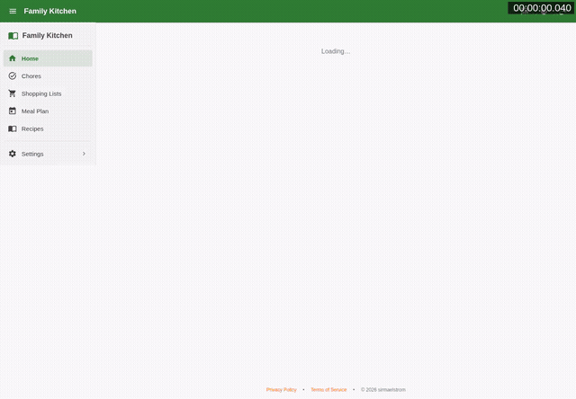

### Video review: PASS

[clip.mp4](clip.mp4) (11.0 s, holds 5 moment(s) for 1.5 s)

| at | severity | what a person sees | expected |
|---|---|---|---|
| 0:00.84 | minor | On the Home to Chores navigation, the content area went fully blank for one frame, and the sidebar and header stayed in place. This blank frame appears again in p03, p04 and p05 as the run moves between pages. In p02 the frame is blank with no 'Loading' text. A person would see a brief blank flash between pages. | The new page should replace the old one directly, or show a loading indicator, with no empty frame between them. |
| 0:01.24 | minor | On the Chores to Shopping List navigation, the content area went blank for one frame, and the floating add button disappeared with it. | The page should switch without an empty frame. |
| 0:01.64 | minor | On the Shopping List to Meal Plan navigation, the content area went blank for one frame. | The page should switch without an empty frame. |
| 0:02.00 | minor | On the Meal Plan to Recipes navigation, the content area went blank for one frame. | The page should switch without an empty frame. |
| 0:02.40 | note | When Settings opened, the page showed 'Loading...' for one frame before the Categories page appeared. The sidebar menu was expanded at the same time. | A loading state on a first view is expected, so nothing here is wrong. |

Judge: No errors, crashes or half-drawn pages. Every page change passes through a one-frame blank content area, which a person could see as a brief flash, and the final Settings view settles correctly.

3.5 s recording at 25 fps · every frame compared · 6 moment(s) of change, 0 flash(es) · 6 panel(s) shown to the judge · judge claude-sonnet-5-5 read 6/6, $0.068, 8 s. Runner verdict: green.

> Reviewer: this clip and the findings table are this PR's evidence of how the UI behaved, from a recording of the real run, watched frame by frame. A review sandbox cannot start a browser, so read them instead of trying one, and say in your review which finding (or "none") you relied on.
