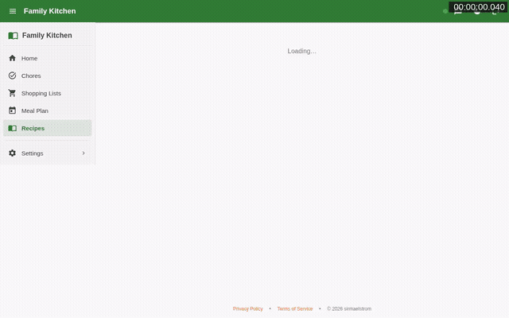

### Video review: NEEDS-LOOK (2 finding(s) at major or above)

[clip.mp4](clip.mp4) (12.0 s, holds 5 moment(s) for 1.5 s)

| at | severity | what a person sees | expected |
|---|---|---|---|
| 0:02.16 | major | The whole content area, including the side navigation and header, goes blank white for a moment when the Recipes page returns. Then the grid appears with the search box still filled in. | The view changes straight to the Recipes page with no empty white frame. |
| 0:02.96 | major | In the meal-plan picker, 'Beef Tacos' is already typed, but the list first shows all five recipes (Beef Tacos, Caesar Salad, Chicken Stir Fry, Grilled Salmon, Spaghetti Bolognese). A moment later it shrinks to only Beef Tacos, so the list visibly jumps. The previous panel (p07) also showed a 'Searching…' line before the full list appeared. | The list shows only the matching recipe once it appears, with no unfiltered list flashing first and no layout jump. |
| 0:00.96 | minor | The 'Recipe deleted.' toast appears at the end of the grid and then moves to the bottom of the screen. It is still on screen at 1:28, 1:92 and 1:96, long after the delete. | The toast appears in one place and goes away after a short time. |
| 0:03.44 | note | The phone-width Categories page shows the 'Deleted a recipe? Restore it from Deleted Recipes.' line and its link opens the Deleted Recipes page. The page shows 'No deleted recipes.' with no overflow. | This is as intended. |
| 0:01.92 | note | The Deleted Recipes list page and the Restore press are not in the changed moments shown. The recording jumps from the Settings menu (with 'Deleted Recipes' listed) to the restored Recipes grid, so I could not confirm the row layout, the Restore button or the 'restored.' toast. | Steps 5 and 6 should be visible, or the reviewer should check them in another recording. |

Judge: The restore flow ends correctly: the recipe is back, still favorited, found in the meal-plan picker, and the phone-width link works. The recording has a blank white frame when the Recipes page returns and an unfiltered list that flashes in the picker before it narrows. The Deleted Recipes page and the Restore press are not visible in the moments I was shown.

4.5 s recording at 25 fps · every frame compared · 9 moment(s) of change, 0 flash(es) · 9 panel(s) shown to the judge · judge claude-sonnet-5-5 read 9/9, $0.084, 15 s. Runner verdict: green.

> Reviewer: this clip and the findings table are this PR's evidence of how the UI behaved, from a recording of the real run, watched frame by frame. A review sandbox cannot start a browser, so read them instead of trying one, and say in your review which finding (or "none") you relied on.
