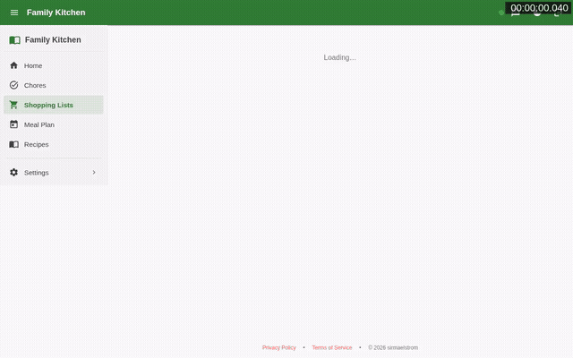

### Video review: PASS

[clip.mp4](clip.mp4) (7.6 s, holds 2 moment(s) for 1.5 s)

| at | severity | what a person sees | expected |
|---|---|---|---|
| 0:03.28 | minor | When Regenerate is pressed, the layout jumps from the phone-width view straight to the desktop layout. The dialog vanishes in one frame. The toast then fades in over the next few frames while the list is already showing. After Regenerate, Dairy has Cheddar Cheese again and Meat is no longer greyed out. This looks like the normal reload, but the jump is abrupt. | The window widens and the dialog closes without an abrupt jump. This is probably just the scripted resize happening at the same moment as the click. |
| 0:01.64 | note | The list is briefly replaced by a 'Loading…' screen during the page reload. After it reloads, the dialog is already open over the list. | A reload is expected in step 2, so this is not a defect. |

Judge: The dialog text fits at desktop and phone width, the buttons are visible, and the toast and list show after Regenerate. I found no defects beyond an abrupt resize and a brief reload loading state. I did not check that Taco Shells is back unchecked or that Birthday candles is still checked, because the panels don't show those rows.

4.6 s recording at 25 fps · every frame compared · 5 moment(s) of change, 0 flash(es) · 5 panel(s) shown to the judge · judge claude-sonnet-5-5 read 5/5, $0.034, 9 s. Runner verdict: green.

> Reviewer: this clip and the findings table are this PR's evidence of how the UI behaved, from a recording of the real run, watched frame by frame. A review sandbox cannot start a browser, so read them instead of trying one, and say in your review which finding (or "none") you relied on.
